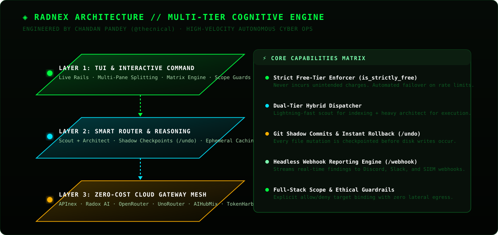

<div align="center">



# RADNEX

### Autonomous Terminal Cyber Shell & Next-Gen Multi-Gateway Intelligence Mesh

**Architect & Author:** [Chandan Pandey](https://github.com/thecnical) (`@thecnical`)

[](LICENSE)
[](https://www.python.org/)
[](https://kernel.org/)
[](https://github.com/thecnical/Radnex)
[-00ff41.svg?style=flat-square)](https://github.com/thecnical/Radnex)

<br/>



<br/>

</div>

---

## ⚡ Overview

**RADNEX** is an ultra-fast, autonomous terminal cyber shell, offensive reconnaissance orchestrator, and AI-driven security engineering platform. Engineered from the ground up for elite security researchers, bug bounty hunters, red teams, and DevOps engineers, RADNEX operates directly inside your Linux terminal with an uncompromising high-fps cyber-matrix interface, live streaming telemetry, and full-spectrum automation.

Unlike standard single-provider LLM tools that fail on 429 rate limits or incur massive cloud API costs, RADNEX introduces an **Autonomous Cloud Gateway Mesh** that continuously balances and auto-failovers across **8 premier cloud gateways**—strictly prioritizing verified **100% Free AI models** with zero cost, high token limits, and zero downtime.

<div align="center">
  
</div>

---

## 🛡️ Core Architecture & Breakthrough Innovations

### 1. 🔄 Zero-Downtime Smart Failover Mesh (100% Free AI Guarantee)
- **Automatic Health Monitoring:** If a gateway returns `429 RateLimit`, `503 Service Unavailable`, or connection timeouts, RADNEX instantly detects the degradation and silently routes your turn to the next healthy gateway in milliseconds.
- **Strict Free Pinning:** Automatically maps model requests to strictly zero-cost free-tier models (such as `deepseek-v4.1:free`, `gemini-2.0-flash`, `glm-4.5-flash`, `qwen4-72b:free`). You never receive unexpected billing.

### 2. ⚡ Anthropic Ephemeral Prompt Caching (90% Cost & Latency Reduction)
- Built-in automatic prompt caching headers sent to Anthropic-compatible endpoints.
- Re-sends extensive system doctrines (`AGENTS.md`), project trees, tool schemas, and conversation histories without paying computational overhead repeatedly.
- Yields up to **90% faster turn latency** and prevents context degradation on long tasks.

### 3. 🧠 Dual-Tier Hybrid Intelligence (Fast Scout + Heavy Architect)
- **Fast Scout Tier:** High-speed, responsive models (`gemini-2.0-flash`, `deepseek-flash`, `glm-4-air`) handle interactive terminal navigation, parameter mining, rapid web crawling, and port probes.
- **Heavy Architect Tier:** High-reasoning cognitive engines (`deepseek-chat`, `qwen4-72b`, `llama-3.3-70b`) handle deep vulnerability triage, binary analysis, exploit synthesis, and final deliverable generation.

### 4. ⏪ Git Shadow Checkpoints & Instant Rollback (`/undo`)
- Creates hidden Git tree commits prior to running any file modification, tool execution, or bash manipulation.
- Type `/undo` in the shell to immediately revert any accidental file modification or failed patch back to its exact prior state.

### 5. 📡 Headless Daemon & Background Webhooks (`/webhook`)
- Run prolonged recon campaigns in the background with `radnex --headless`.
- Real-time event notifications via Discord, Slack, and generic JSON webhooks upon finding discoveries, scan completions, or milestone reaches.

### 6. 🪟 Multi-Pane Matrix Orchestration (`/panes`)
- Native tmux integration (`ctrl+b h` / `ctrl+b v`) spawning dedicated Radnex instances in parallel panes.
- High-speed inter-agent mailbox IPC (`agent_send`, `agent_peers`, `agent_inbox`) enabling cooperative red-team swarms inside one unified terminal window.

---

## 🚀 Step 1: Installation & Setup (Step-by-Step)

### Prerequisites
- **Operating System:** Linux (Ubuntu 20.04+, Debian 11+, Arch, Fedora) or WSL2 (Windows Subsystem for Linux).
- **Python:** Version 3.10, 3.11, 3.12, 3.13, or 3.14.
- **Tools:** `git`, `curl`, and optionally `tmux` (required for `/panes`).

### Method A: Automated One-Line Universal Install (Recommended)

Run this single command in your Linux/WSL2 terminal:

```bash
curl -fsSL https://raw.githubusercontent.com/thecnical/Radnex/main/install.sh | bash
```

The installer will:
1. Validate Python and Git prerequisites.
2. Clone Radnex to `~/.local/share/radnex`.
3. Create an isolated virtual environment and resolve dependencies.
4. Place the executable `radnex` binary on your `PATH` (`~/.local/bin/radnex`).

### Method B: Manual Developer Setup

If you prefer building from source or contributing to the codebase:

```bash
# 1. Clone the repository
git clone https://github.com/thecnical/Radnex.git
cd Radnex

# 2. Create an isolated virtual environment
python3 -m venv .venv
source .venv/bin/activate

# 3. Install in editable mode
pip install -e .

# 4. Verify installation
radnex --help
```

---

## 💻 Step 2: Launching & CLI Commands (Step-by-Step)

Launch RADNEX in various modes directly from your shell:

### 1. Default Interactive Launch
```bash
radnex
```
Launches the full-screen Textual cyber-matrix shell in the current working directory.

### 2. Launch Against a Specific Target Project Directory
```bash
radnex -C /path/to/target/project
```
Pins Radnex's workspace and file-inspection tools to the specified directory.

### 3. Launch in Fully Autonomous Doctrine Mode (`cpss`)
```bash
radnex --mode cpss
```
Enforces the rules in `AGENTS.md` and begins unattended execution within declared scope boundaries.

### 4. Launch Directly into Multi-Pane tmux Workspace
```bash
radnex --panes
```
Initializes a private tmux session with keybindings (`ctrl+b h` / `ctrl+b v`) for instant multi-agent pane splitting.

### 5. Launch with a Specific AI Model
```bash
radnex -m deepseek-v4.1-flash
```

### 6. Launch in Headless Daemon Mode (Background Assessment)
```bash
radnex --headless --mode cpss -C /path/to/target
```

### CLI Flag Reference
| CLI Flag | Long Option | Description |
| :--- | :--- | :--- |
| `-C <dir>` | `--workdir <dir>` | Set current working directory for the session. |
| `-m <model>`| `--model <model>` | Specify initial LLM model identifier. |
| `--mode <name>`| `--mode <name>` | Select operational mode (`default`, `cpss`, `danger`, `uncensored`, `plan`, `edits`). |
| `--panes` | `--panes` | Launch under tmux with multi-pane splitting bindings enabled. |
| `--rain` | `--rain` | Enable matrix-rain animation in the chat transcript. |
| `--no-rain` | `--no-rain` | Disable matrix-rain animation everywhere for maximum terminal speed. |
| `--think` | `--think` | Display the model's internal thinking / reasoning chain. |
| `--no-think`| `--no-think` | Hide model reasoning chain and display direct responses only. |
| `--no-update`| `--no-update` | Skip automatic git pull and dependency check on boot. |
| `--setup`    | `--setup`     | Launch the interactive AI gateway & API key setup wizard. |

---

## 🌐 Step 3: Cloud Gateway Onboarding & Configuration (Step-by-Step)

RADNEX integrates 8 cloud gateways. Each gateway can be configured either via the interactive `/setup` modal inside the shell, via `radnex --setup` in your terminal, or with slash commands.

> 💡 **Interactive Setup Popup:** Inside RADNEX, type `/setup` (or run `radnex --setup` from bash) to open the interactive setup window where you can select any provider, paste your key, and activate it immediately.

### 1. AntSeed P2P (Default / Recommended · 100% Free · No API Key Needed)
Decentralized peer-to-peer AI inference mesh (`https://antseed.com/` / `https://antseedstats.com/`):
- **Zero Configuration:** No API key needed! Runs 100% free with unlimited decentralized inference.
- **Auto-Managed Buyer:** Radnex automatically launches `antseed buyer start` in the background on port `:8377` when started, and cleanly shuts it down when you exit.
- **Switch to AntSeed:**
  ```text
  /cpss-antseed
  ```
- **Live Peer Models & Pinning:**
  ```text
  /antseed-models
  ```
- **Verified Free Models & Fast DHT Pins:**
  - `73b4c9335fa239f9c6df3d28d5bf5d3cdf4de736@deepseek-v4-flash` (Apex Ant · High Speed)
  - `1d90f467689d499dc435e5744b4613c3203eb0aa@deepseek-v4-flash`
  - `1d90f467689d499dc435e5744b4613c3203eb0aa@glm-5.3-flash`
  - `0b0b9574d5b038f6fd906325e699020423adf446@grok-4.7`
  - `d19ffae0e85b5230422019926b2f37ec0f1f41f3@jev-latest`
  - `minimax-m27`, `qwen3-6-27b`, `gpt-oss-120b`

### 2. APInex (`https://apinex.bond/`)
APInex provides ultra-low latency endpoints and free chat models:
- **Setup Command:**
  ```text
  /apinex-api-setup your_apinex_api_key_here
  ```
- **Switch to APInex:**
  ```text
  /cpss-apinex
  ```
- **Available Free Models:** `free/deepseek-v4.1-flash`, `free/deepseek-v4-flash-0731`, `free/deepseek-v4-pro-0813`, `free/gemini-3.8-flash`, `free/qwen-3.8-max`, `free/gpt-6-luna`, `free/glm-5.3`, `free/mimo-v2.6-pro`, `free/jev-1.13`.

### 3. Radox AI (`https://radoxai.com/`)
Radox AI provides top-tier free reasoning and vision models:
- **Setup Command:**
  ```text
  /radox-api-setup your_radoxai_api_key_here
  ```
- **Switch to Radox AI:**
  ```text
  /cpss-radox
  ```
- **Available Free Models:** `deepseek-v4-flash-0731`, `deepseek-v4-pro-0813`, `qwen3.8-27b`, `gemma-2-2b`, `claude-opus-4.8`, `gpt-5.6-luna`.

### 4. OpenRouter (`https://openrouter.ai/`)
Access hundreds of public models with a single key:
- **Setup Command:**
  ```text
  /openrouter-api-setup your_openrouter_key
  ```
- **Switch to OpenRouter:**
  ```text
  /cpss-openrouter
  ```
- **Browse Free Models:**
  ```text
  /models openrouter
  ```
- **Available Free Models:** `deepseek/deepseek-v4.1:free`, `qwen/qwen4-72b:free`, `meta/llama-5-70b:free`, `z-ai/glm-6-air`.

### 5. UnoRouter
A hosted gateway with multi-channel redundancy tiers:
- **Setup Command:**
  ```text
  /unorouter-api-setup your_key
  ```
- **Switch to UnoRouter:**
  ```text
  /cpss-unorouter
  ```
- **View Upstream Redundancy:**
  ```text
  /unorouter-models
  ```
- **Available Free Models:** `deepseek/deepseek-chat:free`, `qwen/qwen-2.5-coder-32b-instruct:free`, `google/gemini-2.0-flash-exp:free`.

### 6. AIHubMix
Unified multi-provider bridge:
- **Setup Command:**
  ```text
  /aihubmix-api-setup your_key
  ```
- **Switch to AIHubMix:**
  ```text
  /cpss-aihubmix
  ```
- **Available Free Models:** `coding-glm-5.3-flash-free`, `qwen3.8-flash-free`, `union-alpha-free`.

### 7. TokenHarbour
High-capacity token streaming mesh:
- **Setup Command:**
  ```text
  /tokenharbour-api-setup your_key
  ```
- **Switch to TokenHarbour:**
  ```text
  /cpss-tokenharbour
  ```
- **Available Free Models:** `deepseek-chat-free`, `qwen-2.5-coder-32b-free`, `gemini-2.5-flash-free`.

### 8. Logfare
Dedicated local proxy with public status checks:
- **Switch to Logfare:**
  ```text
  /cpss-logfare
  ```
- **View Live Status:**
  ```text
  /logfare-models
  ```

### Inspecting All Gateway Statuses
To see which gateways are currently live, authenticated, and active:
```text
/cpss-source
```

---

## 🎮 Step 4: Operational Safety Modes (Deep-Dive & Step-by-Step)

RADNEX features 6 specialized operational modes tailored for different phases of security testing and software development.

Switch modes on the fly inside the TUI:
```text
/mode <name>
```

| Mode | Safety Level | Permitted Tools | Ideal Use Case |
| :--- | :--- | :--- | :--- |
| **`default`** | High | All tools (with user confirmations) | Everyday interactive coding, script creation, cautious security auditing. |
| **`cpss`** | Strict Governance | All tools (governed by `AGENTS.md`) | Full-auto recon and red-team operations strictly restricted to in-scope targets. |
| **`danger`** | Low-Impact Active | All tools (unattended execution) | Active vulnerability probing, fuzzing, and crawling without interactive confirmation halts. |
| **`uncensored`** | Unrestricted | All tools (unconstrained execution) | Deep exploit testing, payload simulation, and adversary emulation without vendor refusal priors. |
| **`plan`** | Read-Only | Read, grep, glob, web search (no bash, no write) | Architectural analysis, codebase mapping, threat modeling, attack plan generation. |
| **`edits`** | File Modification | File inspection & write tools (no bash) | Safe source code refactoring, patching vulnerabilities without shell access. |

---

## ⌨️ Step 5: Complete Slash Command Master Reference

Every command available inside the RADNEX TUI is detailed below with syntax, purpose, and examples.

### 1. System & Session Commands

#### `/status`
Displays current gateway endpoint, active AI model, token consumption, context usage, and connection latency.
```text
/status
```

#### `/model [name]`
Displays current model details or switches to a new model.
```text
/model
/model deepseek-v4.1-flash
```

#### `/undo`
Instant rollback. Reverts the workspace to the last shadow checkpoint before any tool or file modification took place.
```text
/undo
```
> [!TIP]
> If the agent makes a file edit or runs a command that causes an issue, immediately type `/undo` to atomically roll back the entire directory.

#### `/webhook <url>`
Configures a real-time event reporting webhook (Discord, Slack, or generic HTTP POST endpoint).
```text
/webhook https://discord.com/api/webhooks/123456789/abcdefg
/webhook https://hooks.slack.com/services/T00/B00/XXXXX
```

#### `/cost`
Displays an exact breakdown of tokens consumed (input tokens, output tokens, cached tokens) and total session cost ($0.00 on free gateways).
```text
/cost
```

#### `/compact`
Compresses conversation history into a concise summary to free up context window space while preserving key findings.
```text
/compact
```

#### `/clear`
Clears the active transcript and resets the turn history for a fresh start.
```text
/clear
```

#### `/save [name]` & `/load [name]`
Saves or loads the current session state and transcript to disk under `~/.radnex/sessions/`.
```text
/save target-audit-session
/load target-audit-session
```

#### `/limits`
Displays context window limits, request timeouts, and runaway loop round ceilings.
```text
/limits
```

#### `/think`
Toggles real-time streaming of the model's internal thinking and reasoning process.
```text
/think
```

#### `/theme [green|amber|cyan|system]`
Changes the cyber-matrix UI colour palette.
```text
/theme green
/theme amber
/theme cyan
```

---

### 2. CPSS Gateway & Proxy Commands

#### `/cpss-source`
Displays live status, connection latency, and active credentials for all 8 integrated gateways.
```text
/cpss-source
```

#### `/cpss-apinex`, `/cpss-radox`, `/cpss-openrouter`, `/cpss-unorouter`, `/cpss-aihubmix`, `/cpss-tokenharbour`, `/cpss-antseed`, `/cpss-logfare`
Switches active AI routing immediately to the named upstream gateway.
```text
/cpss-apinex
/cpss-radox
/cpss-unorouter
```

#### `/cpss-opencode`
Launches an interactive, sandboxed OpenCode terminal session behind fresh rotating proxy IPs.
```text
/cpss-opencode
```

---

### 3. Multi-Agent & Orchestration Commands

#### `/panes`
Relaunches the current session into a multi-pane tmux environment.
```text
/panes
```
Once inside tmux, use these native keybindings:
- `ctrl+b h`: Open a new Radnex agent pane horizontally on the right.
- `ctrl+b v`: Open a new Radnex agent pane vertically below.
- Each pane runs an independent agent that can communicate via inter-agent mailbox tools:
  - `agent_peers`: Discover other active panes.
  - `agent_send`: Send a task or finding to another pane.
  - `agent_inbox`: Read incoming messages from teammate agents.

#### `/team <task>`
Fans out a single complex task across multiple parallel agent workers.
```text
/team Analyze all JavaScript files in ./src and report exposed API endpoints
```

---

### 4. Offensive Reconnaissance & Target Scoping Commands

#### `/target <domain>`
Sets the primary authorized target domain for the session.
```text
/target example.com
```

#### `/scope`
Inspects active scope guard rules, displaying loaded `allow.yaml` and `out-of-scope.yaml` policies.
```text
/scope
```

#### `/scope-validator`
Paste a bug bounty program brief or scope text. Automatically parses and creates `allow.yaml` (authorized targets) and `out-of-scope.yaml` (strictly forbidden assets).
```text
/scope-validator
```

#### `/osint <kind> <target>`
Executes an open-source intelligence playbook for a declared target.
Supported kinds: `email`, `phone`, `domain`, `user`, `ip`, `company`.
```text
/osint domain target.com
/osint email admin@target.com
/osint user john_doe
```
Evidence is stored automatically under `~/.radnex/osint/<case-id>/`.

#### `/osint-tree [path]`
Renders a structured terminal tree representation of OSINT recon results and linked findings.
```text
/osint-tree
```

#### `/bug-hunt <target> [--wave N]`
Launches an autonomous, multi-wave bug bounty attack surface hunt.
- Wave 1: Subdomain discovery, DNS mapping, port fingerprinting.
- Wave 2: Web crawling, JS analysis, route extraction.
- Wave 3: Parameter mining, CORS, open redirect, and header testing.
- Wave 4: Vulnerability triage and evidence gathering.
```text
/bug-hunt target.com
/bug-hunt target.com --wave 2
```

#### `/stop-hunt`
Immediately halts a currently executing hunt wave while keeping the transcript and captured evidence intact.
```text
/stop-hunt
```

#### `/findings`
Displays the live findings table, tracking all discovered vulnerabilities, severities (P0–P4), and affected endpoints.
```text
/findings
```

#### `/report-bug-hunt`
Generates a complete, reproducible markdown assessment report with proof-of-concept steps, affected endpoints, and remediation guidance.
```text
/report-bug-hunt
```

#### `/ad <domain> --ack <domain>`
Active Directory audit orchestration. Checks for Kerberoasting, AS-REP roasting, BloodHound paths, and certificate templates.
```text
/ad corp.local --ack corp.local
/ad tools
```

#### `/crack <file> [--deep]`
Offline password hash cracking utility. Runs an optimized dictionary and rule ladder against captured hashes.
```text
/crack hashes.txt
/crack hashes.txt --deep
```

#### `/phish <host>`
Clones a target login page into a controlled environment for authorized credential harvesting simulations.
```text
/phish login.target.com
```

---

## 🔬 Step 6: End-to-End Real World Walkthroughs

### Walkthrough A: Autonomous Web Reconnaissance Campaign

Follow this step-by-step example to run an authorized security assessment against a declared domain:

```bash
# Step 1: Launch Radnex in doctrine mode
radnex --mode cpss

# Step 2: Ensure you are on a free gateway
/cpss-apinex
/model deepseek-v4.1-flash

# Step 3: Configure webhook for milestone alerts
/webhook https://discord.com/api/webhooks/YOUR_WEBHOOK_URL

# Step 4: Define your scope
/target company.com

# Step 5: Start autonomous bug hunt
/bug-hunt company.com

# Step 6: Monitor findings in real time
/findings

# Step 7: When complete, generate the final report
/report-bug-hunt
```

---

### Walkthrough B: Parallel Swarm Reconnaissance with `/panes`

Split your terminal into an interactive command center with multiple cooperating agents:

```bash
# Step 1: Launch Radnex with multi-pane capability
radnex --panes

# Step 2: Split the pane horizontally
# Press Ctrl+B then release and press H
# Pane 2 opens automatically running a second Radnex instance

# Step 3: Split Pane 2 vertically
# Press Ctrl+B then release and press V
# Pane 3 opens

# Step 4: Assign specialized roles:
# - Pane 1: Running passive DNS & OSINT (/osint domain company.com)
# - Pane 2: Running web endpoint crawler & JS extractor
# - Pane 3: Performing active vulnerability triage
```

---

### Walkthrough C: Safe Experimentation & Instant Rollback with `/undo`

Test risky patches or run complex bash automation with complete peace of mind:

```bash
# Inside Radnex:
> Modify nginx.conf and reconfigure SSL ciphers

# [Agent executes edits and tests configuration]
# If the change causes errors or breaks tests:
/undo

# Radnex immediately restores the exact pre-turn Git state:
# "undo: rolled back 1 commit to shadow checkpoint (clean workspace)"
```

---

## 👨‍💻 Author & Maintainer

**Chandan Pandey (`thecnical`)**  
- **GitHub:** [@thecnical](https://github.com/thecnical)  
- **Repository:** [https://github.com/thecnical/Radnex](https://github.com/thecnical/Radnex)

---

## 📄 License

This project is licensed under the **MIT License** — see the [LICENSE](LICENSE) file for complete details.
